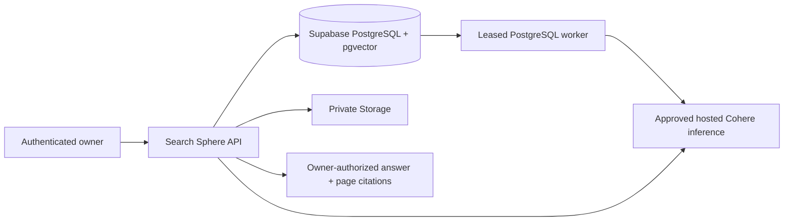

# Search Sphere

The reusable [search-sphere-ingest package](packages/search-sphere-ingest/README.md)
provides independent PDF/image extraction and content-aware chunking. Search Sphere
keeps its hosted Cohere policy, private storage and PostgreSQL/pgvector pipeline.
See the [implementation and acceptance report](docs/DOCUMENT_INTELLIGENCE_RELEASE.md)
and [free-tier reliability setup](docs/FREE_TIER_RELIABILITY.md) for tested behavior,
optional providers and remaining live release gates. Warming is best effort;
Render Free does not guarantee continuous availability.

Search Sphere is a standalone application for private, per-user PDF storage,
search and grounded questions and answers. Quick-Clinic and ExamArena will build
separate chatbots; this application does not serve their chatbot APIs or depend
on their releases.



The runtime uses FastAPI/Python 3.12, Next.js, Supabase PostgreSQL/pgvector and
private object storage. Deterministic PyMuPDF parsing, layout cleanup and chunking
run in the service. Embeddings, reranking, generation and model-based image
extraction use hosted Cohere APIs. No local inference weights, RabbitMQ, Redis or
Qdrant service is needed.

Documents and conversations are scoped to their authenticated owner. Sources and
citations are checked against current PostgreSQL permissions before answers are
returned. The durable worker uses atomic claims, leases, bounded retries and
restart recovery; deletion revokes access immediately and verifies physical
vector/object cleanup afterward.

## Development

Use **uv** for Python and **pnpm** for JavaScript. Copy `.env.example` to a private
`.env` and configure the intended database, private Storage and server-only
credentials. Never commit it. Install the reviewed development requirements with:

```sh
uv venv apps/api/.venv
uv pip install --python apps/api/.venv/bin/python -r apps/api/requirements.txt
cd apps/web
pnpm install --frozen-lockfile
```

The default Docker Compose stack contains PostgreSQL/pgvector, the API, a separate
worker and the web app. It does not launch legacy broker/vector/cache services.
Production uses the free Render service with its worker in the API process to
avoid an additional service charge. API and worker images use only
`apps/api/requirements-production.txt`; the optional historical Qdrant test client
in development requirements is not installed in either runtime image.

## APIs and release checks

The native application uses `/auth`, `/documents`, `/search`, `/answer`,
`/conversations` and `/feedback`; `/openapi.json` is the current contract.
`/api/v1/*` and `/internal/medical-*` are retired and return 404.

[Standalone scope and requirement status](docs/STANDALONE_SCOPE.md) records the
change, data preservation and remaining work. The former integration modules and
schema history remain for safe migration and historical regressions, with a
separate test-only application excluded from production images. They do not
provide an enabled consumer feature.

GitHub Actions runs real PostgreSQL/pgvector migrations, ownership/recovery/failure
regressions, frontend tests and network-disabled image checks. The pinned release
workflow admits successful exact-main CI before deployment. Its separate live
phase verifies a new PDF → indexed → unique-marker retrieval → grounded cited
answers → SSE completion → deletion and physical cleanup. It also requires the
retired consumer endpoints to remain unavailable. See
[the runtime guide](docs/CANONICAL_WORKER.md) and
[the provider policy](docs/COHERE_INFERENCE.md).

## Free/trial inference

Use only free infrastructure and the owner-confirmed Cohere trial. The application
caps monthly provider reservations at 900 and has no paid fallback. Only approved
public/synthetic evaluation content is currently eligible. Unknown, company,
medical or personal content stays blocked until an eligible provider and explicit
approval exist. Being the document owner does not establish provider eligibility.
A successful synthetic live check does not authorize another account's content.

The [earlier rollout ledger](docs/ROLLOUT_REQUIREMENTS.md) preserves historical
proof and limitations; its multi-application chatbot requirements are superseded
by the standalone scope. Broad retrieval/answer quality measurements and complete
changed-file replacement/version cutover remain open.
