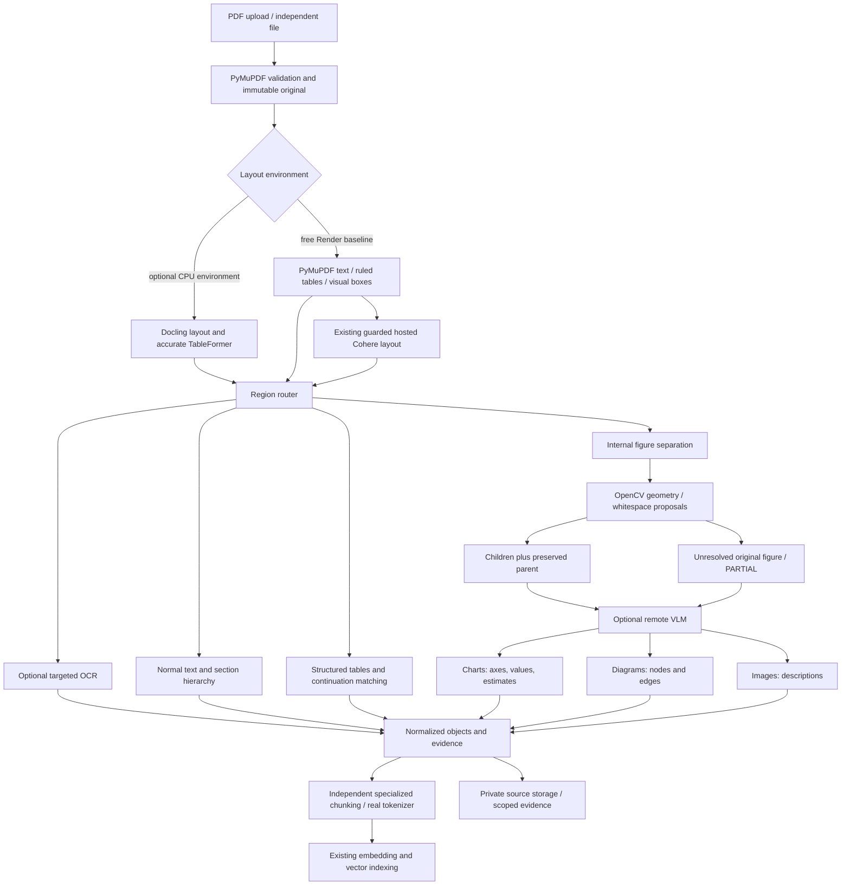

# Architecture

This release candidate separates parsing and chunking from Search Sphere's web
application. The core imports no application routes, ORM, authentication, vector
database or generative model runtime. Optional adapters are imported explicitly.

The native profile uses the existing whitespace-based reading-order strategy,
native table algorithm, conservative continuation tests and source-reference
conventions. A new package boundary adds validated schemas, stable identities,
sentence offsets, hierarchy-aware overlap, explicit partial status, resource
checks and independently installable artifacts. Chart interpretation and literal
OCR remain separate evidence; numeric/edge claims are never self-verified.

Search Sphere retains Supabase PostgreSQL/pgvector, its 384-dimensional
`embed-english-light-v3.0`, exact hosted tokenizer, hybrid retrieval, citations,
ownership checks, deletion tombstones, cleanup intents and lease-fenced publication.
Qdrant was already retired as the deployed default before this work; this change
does not migrate or rebuild vectors. Its compatibility code is preserved.

The application keeps its existing PyMuPDF/Cohere extractor and normalizes those
blocks through `apps/api/src/services/package_chunking.py`. The shared strict
hosted-layout schemas distinguish text, tables, charts, images and diagrams.
There is no second extraction pass or engine switch. PDFs, images and existing
plain-text ingestion use this one application pipeline. Full original structures
and normalized views are stored in existing scoped `document_evidence` JSONB;
all chunks carry stable `evidence_id` references. Private visual assets are
attached as opaque IDs. No new migration or existing-vector rebuild is needed.

Jobs reuse the PostgreSQL queue: pending/leased/succeeded/retryable or terminal
failure. The package uses PENDING/RUNNING/COMPLETED/PARTIAL/FAILED/RETRYABLE in
its schema, with PARTIAL representing incomplete extraction rather than an index
publication success. Resume currently restarts an expired attempt; per-page
checkpoint continuation is not implemented. Progress callbacks permit host-owned
cancellation. Free Render sleep suspends all work until a later process resumes.

In-process `extract` supports injected providers. `extract_isolated` runs the
native profile in a disposable child with private temporary files, a timeout,
Linux 256 MiB address-space ceiling and 90 CPU seconds. The standalone caller can use that
boundary before tokenization. The existing application extractor remains in a
worker thread with document/crop/call bounds and the container memory ceiling;
thread cancellation does not terminate native parsing. Temporary files are never
durable document storage. Linux container limits provide the final memory bound.
Async convenience methods use threads; cancellation of an await alone cannot kill
a native parsing thread. Use isolation for untrusted uploads.

Original crop boxes, PDF transforms and page rotation are retained. Native pages
are not re-rasterized except when a visual crop is needed. PDF boxes use unrotated PDF points; independent
raster images use original image pixels. A panel points to its parent region and retained crop.
Consumers must retain original bytes and enforce authorization on opaque assets.
